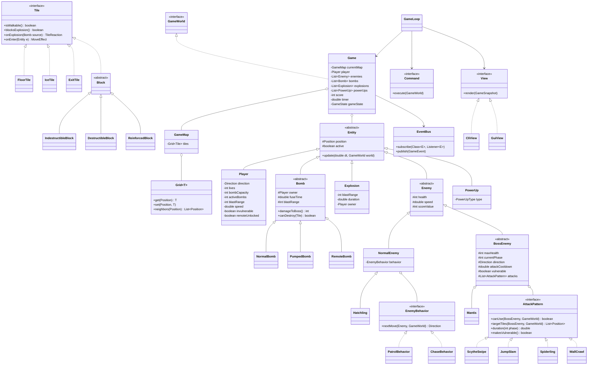

# ARCHITECTURE — Nangor Blast

Technical plan derived from `PRD.md`. Nothing here is implemented yet; this is the agreed target. Task IDs are reused in `TODO.md`.

## Technical Stack

| Area | Choice | Status |
| --- | --- | --- |
| Language | Java, bytecode target 21 | Lead's machine has JDK 26; confirm every member's JDK |
| Build | Gradle through a committed wrapper (`gradlew`) | Wrapper version must support the team's JDK — pending C-01 |
| Task runner | `Makefile` calling `gradlew` (`build`, `run`, `test`, `clean`) | `make` is not installed on the lead's Windows machine — pending |
| Terminal I/O | Lanterna | Chosen |
| GUI (bonus) | JavaFX (Canvas + `AnimationTimer`) via the `org.openjfx.javafxplugin` Gradle plugin | Chosen over LibGDX: simpler setup, coexists with the CLI view |
| Logging | SLF4J + Logback, file appender only | Chosen |
| Tests | JUnit 5 | Chosen |
| Hosting | GitHub `JosephBambang/nangor-blast` | Exists |

## System Structure

### Layers (MVC)

```text
input (keys) ──Command──▶ engine (controller) ──mutates──▶ model (core + streams)
                               │
                               └──publishes GameSnapshot──▶ view.cli / view.gui
```

- **Model** — game state and rules. No dependency on Lanterna or JavaFX.
- **Controller** — the `engine` package: game loop, state machine, command dispatch.
- **View** — renders an immutable `GameSnapshot`. A view never mutates the model.

### Packages and ownership

Root package: `nangorblast`, under `src/main/java/`. Tests mirror it under `src/test/java/`.

| Package | Owner | Responsibility |
| --- | --- | --- |
| `core` | Taufiq | Shared contracts only: `Position`, `Direction`, `Grid<T>`, `Entity`, `Tile`, `GameWorld`, `GameEvent`, `EventBus`, `Command`, `GameSnapshot`, `GameState`, exceptions. |
| `engine` | Taufiq | `GameLoop`, threads, state machine, initialization, restart, score, timer, win/lose check. |
| `input` | Taufiq | Key bindings → `Command` objects. |
| `view.cli` | Taufiq | Lanterna renderer, HUD, menu, how-to-play, pause, and end screens. |
| `player` | Arthuro | `Player`, movement, lives, invulnerability, respawn. |
| `bomb` | Arthuro | `Bomb` hierarchy, `BombFactory`, `Explosion`, propagation, chain reaction, Bomb Kick. |
| `enemy` | Arion | `Enemy` hierarchy, behaviors, boss framework, `Mantis`, `Hatchling`. |
| `view.gui` | Arion | JavaFX view. |
| `world` | Vinandiar | Map loader, validator, tiles, blocks, Ice Tile, power-ups. |
| `editor` | Vinandiar | Map Maker. |

**Boundary rule.** A stream package may import `nangorblast.core` and its own package, nothing else. Only `engine` wires concrete classes together. This is what lets four people work without waiting on each other; the one shared dependency is `core`, which is written first and then frozen.

### Threading model

| Thread name | Job | Shared data |
| --- | --- | --- |
| `input` | Reads keys, builds `Command`s | Writes to a `ConcurrentLinkedQueue<Command>` |
| `game-loop` | Fixed-timestep tick: drain commands → player → enemies and boss → bombs, explosions, map → end check | Sole writer of game state |
| `render` | Draws the latest snapshot | Reads `AtomicReference<GameSnapshot>` |

- Only `game-loop` mutates the model, so no locks are needed on game state and deadlock is impossible by construction.
- Each tick ends by publishing a new immutable `GameSnapshot`.
- `PAUSED` stops the tick's time advance; fuses, cooldowns, and the timer are all driven by tick delta time, so they freeze together.
- Chain explosions are resolved with a work queue and a visited set inside one tick, which bounds the chain.
- Tick rate and render rate are read from `config/` (proposed 30 ticks/s, 20 frames/s).
- Whether this model meets the course's concurrency requirement is to be confirmed at Asistensi 1 (PRD pending #2).

### Cross-stream interaction

Streams never call each other. They interact in two ways:

1. **Queries and mutations through `GameWorld`** (interface in `core`, implemented in `engine`): for example `isWalkable(Position)`, `tileAt(Position)`, `entitiesAt(Position)`, `spawn(Entity)`, `damageAt(Position, DamageSource)`.
2. **Events through `EventBus`**: for example `BombExploded`, `BlockDestroyed`, `EnemyDefeated`, `PlayerDamaged`, `PowerUpCollected`, `BossPhaseChanged`. Score, views, and the logger subscribe.

Examples: the explosion (bomb stream) asks each `Tile` how it reacts instead of knowing block classes; the Ice Tile (world stream) returns a slide effect from `Tile.onEnter` instead of touching `Player`.

### Class diagram

Source for the Milestone 1 class-diagram PDF. Each owner extends their part; the lead merges.



### Required concepts → where they live

| Concept | Where |
| --- | --- |
| Inheritance | `Entity` → `Enemy` → `BossEnemy` → `Mantis`; `Bomb` → three types; `Block` → three types |
| Abstract class / interface | `Entity`, `Bomb`, `Enemy`, `BossEnemy`, `Block` (abstract); `Tile`, `EnemyBehavior`, `AttackPattern`, `Command`, `View`, `GameWorld` (interfaces) |
| Polymorphism | `Tile.onExplosion` and `Tile.onEnter` per tile type; `Bomb.damageToBoss` and `canDestroy` per bomb type; `AttackPattern` per attack |
| Generics | `Grid<T>`; `EventBus.subscribe(Class<E>, Listener<E>)` with `E extends GameEvent` |
| Exceptions | `MapLoadException` (I/O, bad symbol), `InvalidMapException` (fails F00.3), `InvalidConfigException` |
| Collections | `List` of entities, `Queue<Command>`, `Map<Character, …>` symbol registry, `Set<Position>` in explosion and reachability search, `Deque` for chain explosions and BFS |
| Concurrency | Three named threads, `ConcurrentLinkedQueue`, `AtomicReference<GameSnapshot>` |

### Design patterns

| Pattern | Use | Package |
| --- | --- | --- |
| MVC | Overall structure; makes CLI and GUI swappable | all |
| State | `GameState` transitions; boss attack cycle `IDLE → WARNING → ATTACKING → COOLDOWN` | `engine`, `enemy` |
| Strategy | `EnemyBehavior` (patrol, chase); `AttackPattern` (Mantis attacks) | `enemy` |
| Factory | `TileFactory` and entity creation from map symbols; `BombFactory` from the selected `BombType` | `world`, `bomb` |
| Observer | `EventBus` decouples score, views, and logging from game logic | `core` |
| Command | Each input is a `Command` carrying a player ID; enables remapping and two-player keymaps | `input`, `core` |

### SOLID

| Principle | Application |
| --- | --- |
| Single Responsibility | One package per concern; loader, validator, and renderer are separate classes |
| Open/Closed | A new tile, attack, bomb, or view is a new class; `engine` is not edited |
| Liskov Substitution | Any `Bomb`, `Tile`, or `Enemy` subtype works wherever the base type is used; `Hatchling` is a valid `NormalEnemy` |
| Interface Segregation | Streams receive the narrow `GameWorld` view they need, not the whole `Game` |
| Dependency Inversion | Streams depend on `core` interfaces; `engine` injects implementations |

## Implementation Plan

Points are rough effort estimates (1 ≈ half a day). Phase dates are in `WORKFLOW.md`. Every stream task depends only on `C-02` and on earlier tasks of the same owner.

### Engine & Integration — Taufiq

| ID | Step | Pts | Depends on | Completion criteria |
| --- | --- | --- | --- | --- |
| C-01 | Gradle scaffold, wrapper, `Makefile`, folders `src/ config/ docs/` | 1 | — | `make build`, `make run`, `make test`, `make clean` work on a clean clone. |
| C-02 | `core` contracts plus a runnable skeleton with stub streams | 3 | C-01 | All types in the `core` row above compile; the skeleton starts and draws an empty map; each stream has a fake to test against. |
| C-03 | Game loop and threads | 3 | C-02 | Named threads run; commands drain in order; a snapshot is published every tick; a 60 s soak test shows no deadlock. |
| C-04 | Game state machine, initialization, restart | 2 | C-03 | F00.2 steps run in order; restart restores every initial value (F00.4); all five states are reachable. |
| C-05 | Score, timer, win/lose check | 1 | C-04 | F08 table values are awarded; the bonus applies only on `WIN`; timer 0 gives `LOSE`. |
| C-06 | CLI renderer and HUD | 2 | C-02 | The map renders with the `DESIGN.md` glyphs; lives, score, timer, and selected bomb are shown; no flicker. |
| C-07 | Input mapping; menu, how-to-play, pause, and end screens | 2 | C-04 | Menu rules F09.1.2 pass; pause freezes all timers; resume, restart, and back-to-menu work. |
| B-05 | Pattern audit: five patterns documented with code locations | 1 | I-02 | The table above matches the code; text is ready for the buklet. |

### Player & Arsenal — Arthuro

| ID | Step | Pts | Depends on | Completion criteria |
| --- | --- | --- | --- | --- |
| P-01 | Player entity, movement, collision | 2 | C-02 | Moves at its speed; blocked by blocks, enemies, active bombs, and edges; applies a tile's `MoveEffect`. |
| P-02 | Lives, damage, invulnerability, respawn | 2 | P-01 | One life per activation; 1.5 s invulnerability; nearest-free-tile respawn; power-up effects kept. |
| A-01 | Bomb base, Normal Bomb, placement and capacity | 2 | C-02 | 3 s fuse; capacity decreases on placement and returns after the explosion; no re-entry onto an active bomb. |
| A-02 | Pumped Bomb and bomb selection | 1 | A-01 | 4.5 s fuse; range +2 capped at 7; selection persists until changed. |
| A-03 | Remote Bomb and detonate | 1 | A-01 | Usable only when unlocked; no fuse; detonate triggers all of the owner's remote bombs. |
| A-04 | Explosion propagation, damage, chain reaction | 3 | A-01 | All 14 rules of F03.2 pass unit tests; a chain across every bomb on the map resolves in one tick. |
| B-02 | Bomb Kick | 2 | A-04 | The bomb slides until blocked; its fuse keeps running; it still explodes correctly. |
| B-04 | Local multiplayer (co-op) | 2 | P-02 | Two players with separate keymaps, lives, and power-ups; shared score and timer; win/lose per B04. |

### Enemies & GUI — Arion

| ID | Step | Pts | Depends on | Completion criteria |
| --- | --- | --- | --- | --- |
| E-01 | Enemy base and patrol behavior | 2 | C-02 | Follows a defined path; dies to any explosion; contact damages the player. |
| E-02 | Chase behavior | 2 | E-01 | `PATROL ↔ CHASE` switches at 3 tiles; returns to its path after losing the player. |
| E-03 | Boss framework | 3 | E-01 | Warning 1 s → attack → cooldown 5 s; vulnerable for the first 4 s after flagged attacks; phase 2 at half health; no immediate repeat; attacks stop at blocks. |
| E-04 | Mantis: Scythe Swipe and Jump Slam | 2 | E-03 | Areas and durations match F05.3.5 in both phases. |
| E-05 | Mantis: Spiderling (Hatchlings) and Wall Crawl | 2 | E-03 | 3 Hatchlings (4 in phase 2) spawn on free tiles and chase; Wall Crawl repositions, then swipes in phase 2. |
| B-01 | JavaFX view | 5 | C-02 | The full game is playable in a window from the same `GameSnapshot`; the CLI still works. |

### World & Editor — Vinandiar

| ID | Step | Pts | Depends on | Completion criteria |
| --- | --- | --- | --- | --- |
| W-01 | Map file format, loader, spawn data | 2 | C-02 | `config/white-glacier.map` loads to the exact spec layout; an unknown symbol throws `MapLoadException`. |
| W-02 | Map validation | 3 | W-01 | Each F00.3 rule has a failing test map; boss area and exit reachability are checked; an invalid map yields an error and no game. |
| W-03 | Tiles and blocks | 2 | C-02 | The three block types follow F04; a destroyed block becomes walkable. |
| W-04 | Ice Tile sliding | 2 | W-03 | The slide continues to the first normal tile or stops before an obstacle; no direction change mid-slide; bombs are unaffected. |
| W-05 | Power-ups | 2 | W-03 | Five effects with caps; 30% drop; a guaranteed Remote Detonator; only players can pick up. |
| B-03 | Map Maker with save and load | 4 | W-02 | Create or edit a map, validate it, save it, load it, and play it. |

### Integration and deliverables

| ID | Step | Owner | Depends on | Completion criteria |
| --- | --- | --- | --- | --- |
| M-01 | Schedule Asistensi 1 with the assistant | Taufiq | — | Time agreed at least 24 h ahead. |
| M-02 | Asistensi 1 | All | M-01 | Held by 16 Nov; pending PRD questions answered; every attendee submits the form within 1 h. |
| M-03 | Invite the assistant to the repository | Taufiq | — | Invitation accepted. |
| M-04 | Class-diagram PDF | All, merged by Taufiq | C-02 | Diagram above extended by each owner and exported to `docs/`. |
| M-05 | Task-division PDF | Taufiq | — | `docs/TASK-DIVISION.md` exported to `docs/`. |
| M-06 | Submit Milestone 1 | Taufiq | M-03, M-04, M-05, C-01 | Form submitted by 17 Nov 20.10; tag `milestone-1`. |
| I-01 | Integration checkpoint 1 (MVP) | Taufiq + all | C-03–C-07, P-01, P-02, A-01, A-04, E-01, W-01, W-03 | One build on `develop` is playable from menu to `WIN` or `LOSE` (22 Nov). |
| I-02 | Integration checkpoint 2 (feature freeze) | Taufiq + all | all Must tasks | Every PRD acceptance criterion for US-01…US-09 passes (28 Nov). |
| M-07 | Asistensi 2 | All | I-02 | Held by 3 Dec; forms submitted. |
| I-03 | Final integration test | All | I-02, bonuses | Full manual test script passes with bonuses on; no known crash. |
| M-08 | Buklet (A5, ≤15 pages, PDF) | All; editor pending | I-02 | Contains every item listed in the spec's Buklet section. |
| M-09 | Log activity | All, merged by Taufiq | — | One document with a table per member in the spec format. |
| M-10 | Release `v1.0.0` and submit Milestone 2 | Taufiq | I-03, M-08, M-09 | Release holds source, buklet, and log; repo public; form submitted before 4 Dec 20.10. |
